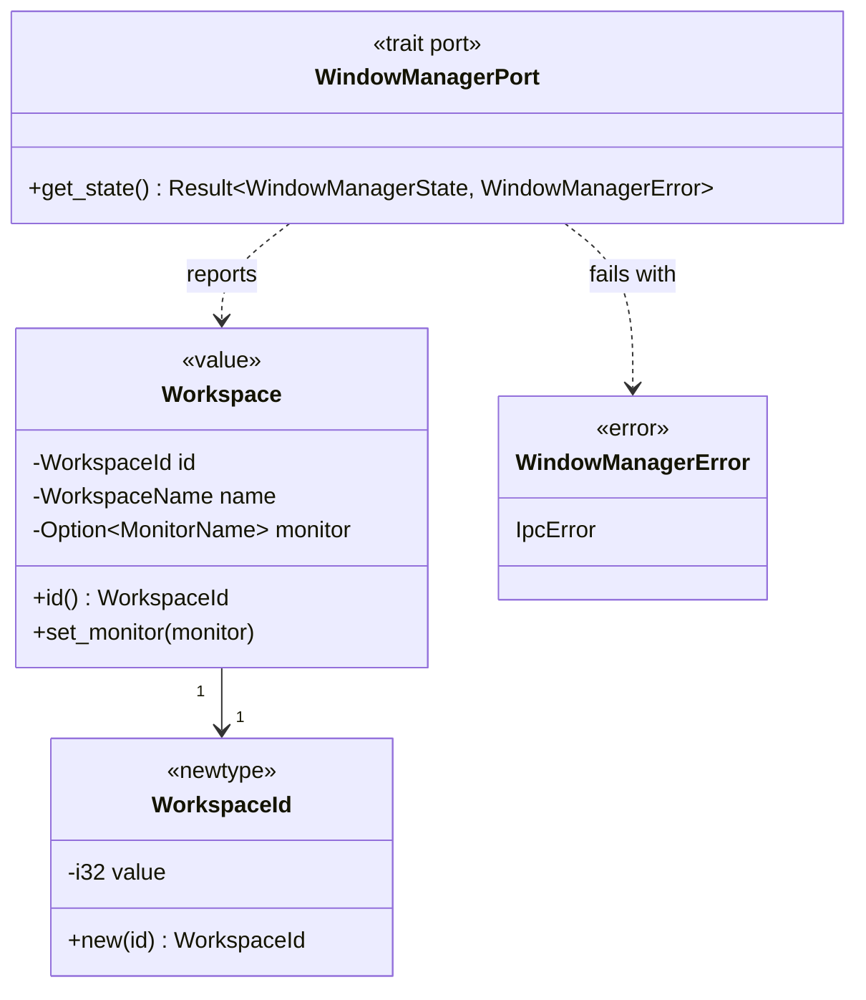

# SPDD REASONS Canvas

Generate an implementation-ready structured prompt using the REASONS Canvas, specialised for **Cranky**: a modular Wayland bar for Hyprland, written as a Rust 2024 Cargo workspace (the `cranky` binary and library plus the member crates `cranky-unsafe` and `cranky-time`), with hexagonal ports and adapters inside feature-sliced design, a reactive signal hub, Lua and Rhai widget scripts, forbid-level lints, arch-lint layer rules and a 200-LOC file limit.

**Input**: a GitHub issue whose body holds the analysis from `/spdd-analysis` under `## Analysis`, plus optional `@` reading material.

```text
/spdd-reasons-canvas #95
/spdd-reasons-canvas #95 @src/shared/dbus/ports.rs
```

## Steps

1. **Resolve the work item (REQUIRED)**

   a. Extract the issue number from the input: `#12`, `GH-12`, an issue URL, or the `GH-<n>-` prefix of a referenced `spdd/prompt/` file. If there is none, ask the user. Never invent a number.

   b. Verify it with `gh issue view <n> --json number,title,state,body`. Not found → stop. Closed → warn and ask. The title and body, with `## Analysis`, are the business context.

   c. **Taxonomy.** `AGENTS.md` "Issues, branches and commits" requires exactly one `type:*` label, at least one `area:*` label, the release milestone and an open parent unless the issue carries `epic`. Read them with `gh issue view <n> --json labels,milestone,parent`. Warn, naming the missing field, and ask whether to continue.

   d. **Exemption.** `AGENTS.md` "SPDD" exempts `type:spike` issues: a spike explores, so there is nothing to design yet. Say so and ask whether to continue anyway; never refuse.

   **Size gate.** SPDD is for issues whose Effort on the Project board is 5 or more. Read the size: `gh project item-list 7 --owner jaoppb --limit 1000 --format json`, then the `effort` of the item whose `content.number` is `<n>`. Below the threshold, not set, or unreadable → stop with one short message and ask "Continue anyway?". Never refuse; on no, change nothing.

   **Analysis check.** If the requirement has no `## Analysis` heading, stop and tell the user to run `/spdd-analysis #<n>` first. A canvas written from a bare requirement has no mapping onto the code, no decisions and no risks.

2. **Consolidate the context**

   - The requirement, including `## Analysis`, is the context. If the input adds requirement text the requirement lacks, ask the user to add it there first.
   - Read ALL `@` references completely (every relevant file in a folder). Report any that fail.
   - Do NOT summarise or truncate.

3. **Read the ground rules and the relevant code**

   Always read:
   - `AGENTS.md`: the canonical rules
   - Read the root `Cargo.toml` (workspace members, `[workspace.dependencies]`, `[lints]`)
   - Read `clippy.toml` (the identifier allow-list, the test-only relaxations, `allowed-duplicate-crates`)
   - Read `arch-lint.toml` (the layer scopes and the rules between them)
   - Read `Justfile` (the `check` gate and the recipes it runs)
   - Skim `tests/architecture.rs` (the structural gate: lint tables, zero exceptions, LOC limits, layer rules)

   Then, scoped to the requirement:
   - The affected modules and their layers
   - The existing shared types to reuse before inventing new ones
   - The existing interfaces and implementations in the affected modules, and the tests and test doubles
   - The memory tools (ai-memory `memory_query` and `memory_recent`), for gotchas and prior decisions on the affected area. They are optional and advisory: if they are unavailable, say so in one line, and the repository documents win on any conflict.

4. **Apply the REASONS Canvas.** Generate fully populated content for all seven sections.

### R: Requirements

```text
## Requirements
- Issue: #<n> — <issue title>
[Concise verb phrases describing the essence of the requirement]

### Definition of Done
- [Observable, verifiable outcomes]

### Out of scope
- [Explicit exclusions]
```

- What problem, for whom, and what value; the scope and what is explicitly not done
- Verb phrases ("Record…", "Derive…"); abstract the essential problem instead of listing features
- The core requirement fits in one sentence, and the Definition of Done is testable

### E: Entities

````text
## Entities

````

- Mark every type with a stereotype: `<<value>>`, `<<newtype>>`, `<<enum>>`, `<<trait port>>`, `<<adapter>>`, `<<error>>`, `<<command>>` (a channel message such as `SystemCommand`)
- Under the diagram, note the owning slice and layer of each type
- **Fields are private** (`-`) and exposed through getters (`+`), as `AGENTS.md` convention 4 requires.
- **Identifiers are newtypes**: ids and names wrap their primitive (`WorkspaceId`, `MonitorName`), as the existing domain does.
- **Errors are types**: one `thiserror` `<<error>>` enum per module or adapter, with its variants (`AGENTS.md` convention 5).
- **Ports belong to the slice that needs them** (`ports/`), and adapters implement them (`adapters/`). Ports get no `Debug` supertrait.
- **Exported types are `Debug` and documented with their intent** (`AGENTS.md` "Public surface").
- **Per-monitor state is keyed by `MonitorId`**: multi-monitor is a first-class dimension.
- **Boundary shapes** (Hyprland JSON DTOs, D-Bus values, script tables) are modelled only in the adapter that parses them.
- **Placement respects the 200-LOC limit**: under `src/features/` and `src/shared/`, a unit that would outgrow one file is a directory of small submodules.

**Conservative constraints (CRITICAL)**: reuse existing types first; leave current types unchanged when they already meet the requirement; restructure only when the requirement cannot be met otherwise; extend rather than rebuild. No speculative abstractions.

### A: Approach

```text
## Approach
1. Domain design:
   - [Value types, invariants, per-monitor state; key decisions and rationale]
2. Slice boundaries and flow:
   - [Which feature slice or shared unit owns what; ports declared; how `src/app/` wires the adapter]
   - [Which `SignalKind` carries the change, who subscribes, which task runs it]
3. Script API:
   - [Changes visible to Lua and Rhai widgets, made in both adapters, or "None"]
4. Error strategy:
   - [`thiserror` enums per module or adapter; how an error surfaces: module error signal, log, boot error]
5. Integration:
   - [Hyprland IPC, D-Bus, Wayland, rendering; what crosses an adapter]
6. Test strategy:
   - [Unit tests with hand-written fakes and `block_on`; integration tests against a private `dbus-daemon` or headless `sway` when an adapter changes]
```

- Follow `AGENTS.md`
- Give the rationale for each decision and name the rejected alternatives
- Name the risks and how the design contains them

### S: Structure

```text
## Structure

### Slices and modules
1. `src/shared/<unit>/domain` — [new or changed shared value types]
2. `src/features/<slice>/domain` — [value types, invariants]
3. `src/features/<slice>/ports` — [traits]
4. `src/features/<slice>/adapters` — [port implementations]
5. `src/app/` — [wiring: registry, bootstrap, which adapters start]
6. `assets/widgets/`, `assets/styles/` — [script or CSS changes] or "None"

### Trait implementations
1. `HyprlandAdapter` implements `WindowManagerPort`
2. `FakeHyprland` implements `HyprlandProvider` (test fake)

### Dependencies
1. [Adapter] depends on [port or provider]
2. [`src/app/` wiring] provides [adapter] for [port]
3. New crate dependencies: [crate = version, which slice uses it, why] or "None"

### Boundary rules
1. [`arch-lint.toml` scopes or rules to add or confirm]
2. [Files that must split to stay within 200 production LOC]
```

- `domain` and `ports` never import `adapters` or `app`; `features` and `shared` never import `app` (`arch-lint.toml`, checked by `arch_lint::check!()` in `tests/architecture.rs`)
- `src/app/` is the composition root: it builds the adapters, wires them to the ports and starts them; nothing depends on it
- `unsafe` code lives only in `crates/cranky-unsafe`; the `cranky` crate forbids `unsafe_code`
- A change to the scripting API is made in both the Lua and the Rhai adapters (`src/shared/scripting/adapters/`) and covered by the same tests in `src/app/builtins.rs`
- Visibility follows `AGENTS.md` "Public surface": an item is only as visible as its uses
- A crate that appears twice in `Cargo.lock` is listed in `allowed-duplicate-crates` (`clippy.toml`) and in the `skip` entries of `deny.toml` with its reason, and `just deps-check` passes; justify each new dependency in the Approach
- Every component has exactly one home, and the dependency graph stays acyclic and within the boundary rules

### O: Operations

```text
## Operations

### 1. Create value type - `WorkspaceName` (`workspaces::domain`)
1. Responsibility: [what it guarantees]
2. Representation: [private inner type and invariants]
3. Constructor: `new(name: impl Into<String>) -> WorkspaceName` — [validation, if any]
4. Behaviour: [getters and methods, each with purpose and signature in prose]
5. Tests: [behaviour cases, named after the behaviour]

### 2. Define port - `WindowManagerPort` (`workspaces::ports`)
1. Contract: [methods, errors, guarantees]
2. Fake: [the hand-written test double the callers' tests use]

### 3. Implement adapter - `HyprlandAdapter` (`workspaces::adapters`)
1. Implements: [port]
2. Parsing: [boundary DTOs, kept inside the adapter]
3. Error mapping: [provider error → port error]
4. Tests: [unit tests with a fake provider; an integration test in `tests/integration/` when it talks to a real server]

### 4. Wire in `src/app/` - [where the adapter is built and which signal starts it]
### 5. Update boundaries - `arch-lint.toml`
### 6. Docs - an intent-stating doc on every exported item; `AGENTS.md` when a rule changes
### 7. Verify - `just check`
```

- **Order by dependency**: shared value types → slice domain → ports → adapters → script API (Lua and Rhai together) → `src/app/` wiring → widgets and styles → boundaries → docs → verify
- Every operation names its slice and module, has one responsibility, and lists its tests (behaviour, not implementation)
- Write signatures in prose with inline code, never in code blocks (e.g. `get_state(&self) -> Result<WindowManagerState, WindowManagerError>`)
- The operations cover everything in Structure, with no logical gaps, and `/spdd-generate` can execute them directly
- **The last operation is always** `just check` passing with zero lint exceptions

### N: Norms

```text
## Norms
1. Baseline: `AGENTS.md` applies in full (Conventions, Hard constraints, Architecture, Testing)
2. Errors: [error enums and messages specific to this change]
3. Naming: [identifiers of three or more characters outside the allow-list; unprefixed CSS classes]
4. Visibility and docs: [the narrowest visibility for each new item; the intent each doc states]
5. Logging: [`tracing` levels and explicit spans]
6. Tests: [what is unit-tested, what needs an integration test]
```

- Do not restate `AGENTS.md`; reference it and add only what is specific to this change
- Zero lint exceptions: no `#[allow(...)]`, `#[expect(...)]` or `#![allow(...)]`, and no macro that emits one (`#[tokio::test]`, `#[tokio::main]`, `#[tracing::instrument]`, `mockall`). Design the code to fit the rule.
- Use the same patterns as the existing modules

### S: Safeguards

```text
## Safeguards
1. Functional: [invariants with exact conditions]
2. Multi-monitor: [state keyed by `MonitorId`; behaviour with zero, one and several monitors]
3. Architecture: [layer rules; no `app` import from features or shared; `unsafe` only in `cranky-unsafe`]
4. Lints: [`just lint` and `just doc-check` pass with zero exceptions]
5. Errors: [exact error enum variants and Display messages]
6. Script API: [Lua and Rhai behave the same; the same tests in `src/app/builtins.rs`]
7. Performance: [no blocking inside an `EventLoop`; render and refresh cost; `just bench-check`]
8. Size: [every touched file under `src/features/` or `src/shared/` within 200 production LOC]
9. Tests: [required unit and integration tests; line coverage stays at 80% or more]
```

- Each safeguard can be checked by a test, by `just check`, or by review; quantify where possible
- Error messages written here are copied verbatim by `/spdd-generate`

5. **Construct the structured prompt**

   ```text
   # [Derived Requirement Title]

   - Issue: #<n>
   - Analysis: the `## Analysis` section of issue #<n>
   ```

   Then all seven sections, fully populated and in order. **Do NOT include** the raw business context, framework metadata (objective, guidance, quality standards), a timestamp or the framework name. No placeholders or TODOs.

   **No code blocks (CRITICAL)**: no source-language blocks, type or function bodies, query statements or config snippets. Describe signatures in prose with inline code. Mermaid diagrams are allowed.

6. **Save the canvas**

   a. File name: `GH-<n>-{TIMESTAMP}-[{ACTION}]-{scope}-{description}.md`. `TIMESTAMP` is `YYYYMMDDHHmm`. `ACTION` is one of `[Feat]`, `[Fix]`, `[Refactor]`, `[Test]`, `[Docs]`, `[Chore]`. `scope` is the most affected of `layout_engine`, `metrics`, `module_runtime`, `mpris`, `styling`, `systray`, `vdom`, `workspaces`, `config`, `dbus`, `env`, `events`, `primitives`, `rendering`, `scripting`, `wayland`, `app`, `widgets`, or `tooling` for cross-cutting work. `description` is kebab-case, < 10 words.

   b. Create `spdd/prompt/` if it is missing, and write the file there.
   The canvas is an ephemeral working file for the current branch. `spdd/prompt` is gitignored: never stage it, never commit it, and never name it by path in a commit message, an issue or a pull request (write `#<n>` in prose).

   c. **Existing or lost canvas.** If a canvas for this work item already exists, ask whether to update it with `/spdd-prompt-update` instead of writing a second one.
   If it is missing partway through a branch (recreated worktree, new checkout, a switch of agent), regenerate it from `## Analysis` and the code already written (`git diff main...HEAD`), and say that it was regenerated, since it may differ from the first. Anything only the lost canvas knew belongs in the code, its doc comments or the tests.

   **Stale canvas.** If the branch code changed outside the canvas (review fixes, a hand refactor) and more code will be generated from it, rebuild it the same way, with the canvas as a third input. Code wins over the old canvas, and every difference is listed for the user. There is no separate sync step: the canvas only has to be right for the rest of this branch.

   d. Show a summary: the path, a one-line summary of each section, the counts of types, operations and safeguards.

7. **Ask before implementing**: "The REASONS Canvas is ready. Proceed with `/spdd-generate`?"

## Guardrails

- **CRITICAL**: generate fully populated content for all seven sections, never just headers
- Do NOT proceed without a resolved work item, or when the size gate or the analysis check stopped and the user did not confirm
- Do NOT include framework metadata, code blocks, placeholders or TODOs
- Do NOT implement code before the user confirms the canvas
- The file name MUST follow the convention above
- Never stage or commit a file under `spdd/prompt`, and never name a canvas by path outside the working tree
- Every operation MUST name its slice and module and list its tests
- Conservative entity design: reuse existing types and avoid unnecessary refactoring
- Read ALL `@` references completely and merge them with the requirement into one context, preserving its intent
